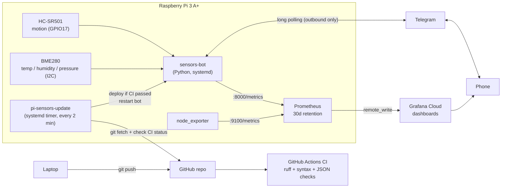

# pi-sensors

A small home IoT project built on a **Raspberry Pi 3 Model A+**: room climate and motion monitoring, a Telegram bot to talk to it from anywhere, Prometheus + Grafana Cloud for metrics and dashboards, and a **GitOps-style, pull-based deployment** gated by GitHub Actions CI.

The goal was to treat a tiny edge device the same way you would treat a production service: code in Git, automated checks, safe automated deploys, observability and remote access without opening any ports.

---

## Features

- **Room monitoring**: temperature, humidity and pressure (BME280), motion detection (HC-SR501 PIR)
- **Telegram bot**:
  - instant motion notifications (rate-limited, can be muted remotely)
  - on-demand readings, Raspberry Pi health status and charts rendered as images
  - **daily morning report** at 08:00 (overnight min/max temperature, humidity, motion count)
  - **weekly summary** every Sunday at 20:00 with a chart and week-over-week comparison
- **Metrics & dashboards**: custom Prometheus exporter in the bot, Prometheus on the Pi with 30-day local retention, `remote_write` to **Grafana Cloud** for dashboards accessible from a phone
- **CI/CD**: GitHub Actions lints and checks every push; the Pi deploys **only commits that passed CI**, then reports the result on Telegram
- **Remote access**: SSH from anywhere via **Tailscale** (no port forwarding, no public IP)
- **Resilience**: everything runs as `systemd` services and comes back on its own after a reboot or power loss

---

## Architecture



### Deployment flow (pull-based)

1. Code is changed on a laptop and pushed to `main`.
2. **GitHub Actions** runs the CI workflow (lint with `ruff`, Python syntax check, Grafana dashboard JSON validation).
3. Every 2 minutes a `systemd` timer on the Pi runs `deploy/pi-sensors-update`:
   - fetches `origin/main`; if there is a new commit, asks the GitHub API for its check-run results,
   - **CI still running** → waits for the next run,
   - **CI failed** → does not deploy and sends a single `❌` Telegram notification for that commit,
   - **CI passed** → `git reset --hard`, installs dependencies, restarts the bot and sends a `🚀` deployment notification with the commit message.

The Pi never accepts inbound connections for deployment. It only pulls, the same idea as GitOps tools like Argo CD, scaled down to a single device. GitHub needs no credentials to the Pi, and the Pi needs no runner (too heavy for 512 MB of RAM).

---

## Hardware

| Component | Notes |
|---|---|
| Raspberry Pi 3 Model A+ | 512 MB RAM, Wi-Fi, Raspberry Pi OS Lite 64-bit |
| BME280 module (GY-BMEP) | I2C address `0x76`; temperature, humidity, pressure |
| HC-SR501 PIR sensor | digital output, ~110° field of view, 3–7 m range |
| Female-female jumper wires | |

### Wiring

| Sensor pin | Raspberry Pi pin |
|---|---|
| HC-SR501 **VCC** | pin 2 (5V) |
| HC-SR501 **GND** | pin 6 (GND) |
| HC-SR501 **OUT** | pin 11 (GPIO17) |
| BME280 **VIN** | pin 1 (3.3V) |
| BME280 **SDA** | pin 3 (GPIO2 / SDA) |
| BME280 **SCL** | pin 5 (GPIO3 / SCL) |
| BME280 **GND** | pin 9 (GND) |

The bot detects at runtime whether the I2C sensor is a BME280 (chip ID `0x60`, with humidity) or a BMP280 (`0x58`, without humidity), since modules sold as either are often mixed up.

---

## Telegram bot commands

| Command | Description |
|---|---|
| `/help` | List all commands |
| `/temp` | Current temperature, humidity and pressure |
| `/status` | Raspberry Pi health: CPU temperature, load, RAM, SD card usage, uptime, power supply (undervoltage) and motion-alert state |
| `/wykres [days]` | Chart image of temperature, humidity, pressure and CPU temperature (default 7 days, max 30) |
| `/raport [hours]` | Report for the last N hours (default 10, same as the morning report) |
| `/tydzien` | Weekly summary with chart and comparison to the previous week |
| `/monitor_on` / `/monitor_off` | Enable / disable motion notifications (persisted across restarts) |
| `/ping` | Health check |

The bot only responds to the configured owner chat ID.

Scheduled messages:
- **08:00 daily**: overnight report (22:00–08:00)
- **Sunday 20:00**: weekly summary

Schedules use the `Europe/Warsaw` time zone and tolerate restarts and clock synchronization after boot.

---

## Metrics

Exposed by the bot on `localhost:8000/metrics` (scraped every 30 s):

| Metric | Type | Description |
|---|---|---|
| `room_temperature_celsius` | gauge | Room temperature |
| `room_humidity_percent` | gauge | Room humidity |
| `room_pressure_hpa` | gauge | Atmospheric pressure |
| `room_sensor_up` | gauge | `1` if the last sensor read succeeded |
| `pi_cpu_temperature_celsius` | gauge | Raspberry Pi CPU temperature |
| `motion_events_total` | counter | Number of motion detections |
| `motion_active` | gauge | `1` while the PIR reports motion |

System metrics (CPU, memory, filesystem) come from `node_exporter`.

The Grafana dashboard (`grafana/dashboard.json`) contains current values, 24h history, motion events per 10 minutes, a minute-by-minute motion timeline and Pi health panels. Implausible sensor values (e.g. a pressure outside 900–1100 hPa caused by a bad I2C read) are filtered out of reports and charts.

---

## Repository structure

```
.
├── bot.py                      # Telegram bot, sensor reading, metrics exporter, reports
├── requirements.txt            # Python dependencies
├── ruff.toml                   # Linter configuration
├── .github/workflows/ci.yml    # CI: lint, syntax check, dashboard JSON validation
├── deploy/
│   └── pi-sensors-update       # Pull-based deploy script (run by a systemd timer)
└── grafana/
    └── dashboard.json          # Grafana dashboard (import into Grafana Cloud)
```

---

## Setup from scratch

### 1. Operating system

Flash **Raspberry Pi OS Lite (64-bit)** with Raspberry Pi Imager. In the settings, configure the hostname (`pi-sensors`), user, Wi-Fi and SSH with a public key.

```bash
sudo apt update && sudo apt full-upgrade -y
sudo raspi-config nonint do_i2c 0
sudo apt install -y git i2c-tools python3-venv python3-gpiozero python3-matplotlib prometheus
```

### 2. Application

```bash
git clone https://github.com/PatryLakos/pi-sensors.git ~/pi-sensors
cd ~/pi-sensors
python3 -m venv --system-site-packages venv
./venv/bin/pip install -r requirements.txt
```

Create `~/pi-sensors/.env` (never committed, listed in `.gitignore`):

```
TOKEN=<telegram-bot-token-from-BotFather>
CHAT_ID=<your-telegram-chat-id>
```

```bash
chmod 600 .env
```

### 3. Bot service

`/etc/systemd/system/sensors-bot.service`:

```ini
[Unit]
Description=Telegram sensors bot
After=network-online.target
Wants=network-online.target

[Service]
User=patryk
WorkingDirectory=/home/patryk/pi-sensors
EnvironmentFile=/home/patryk/pi-sensors/.env
ExecStart=/home/patryk/pi-sensors/venv/bin/python bot.py
Restart=always
RestartSec=10

[Install]
WantedBy=multi-user.target
```

### 4. Automated deployment

```bash
sudo install -m 755 ~/pi-sensors/deploy/pi-sensors-update /usr/local/bin/pi-sensors-update
```

`/etc/systemd/system/pi-sensors-update.service`:

```ini
[Unit]
Description=Pull and deploy pi-sensors from GitHub
After=network-online.target
Wants=network-online.target

[Service]
Type=oneshot
ExecStart=/usr/local/bin/pi-sensors-update
```

`/etc/systemd/system/pi-sensors-update.timer`:

```ini
[Unit]
Description=Check GitHub for pi-sensors updates every 2 minutes

[Timer]
OnBootSec=2min
OnUnitActiveSec=2min

[Install]
WantedBy=timers.target
```

```bash
sudo systemctl daemon-reload
sudo systemctl enable --now sensors-bot pi-sensors-update.timer
```

### 5. Prometheus → Grafana Cloud

Store the Grafana Cloud token in `/etc/prometheus/grafana-cloud-token` (owner `prometheus`, mode `600`), then configure `/etc/prometheus/prometheus.yml`:

```yaml
global:
  scrape_interval: 30s
  external_labels:
    host: pi-sensors

scrape_configs:
  - job_name: pi-sensors
    static_configs:
      - targets: ['localhost:8000']
  - job_name: node
    static_configs:
      - targets: ['localhost:9100']

remote_write:
  - url: <grafana-cloud-prometheus-push-url>
    basic_auth:
      username: <grafana-cloud-instance-id>
      password_file: /etc/prometheus/grafana-cloud-token
```

Set local retention in `/etc/default/prometheus`:

```
ARGS="--storage.tsdb.retention.time=30d"
```

```bash
promtool check config /etc/prometheus/prometheus.yml
sudo systemctl restart prometheus
```

Finally, import `grafana/dashboard.json` in Grafana Cloud (**Dashboards → New → Import**).

### 6. Remote access

```bash
curl -fsSL https://tailscale.com/install.sh | sh
sudo tailscale up --ssh
```

Disable key expiry for the Pi in the Tailscale admin console so access does not silently expire.

---

## Security notes

- Secrets (Telegram token, Grafana Cloud token) live only on the device, in files readable only by their owning user, and are excluded from Git.
- The bot ignores messages from any chat other than the owner's.
- No inbound ports are exposed: Telegram uses outbound long polling, metrics leave via `remote_write`, deploys are pulled, and remote access goes through Tailscale.
- The metrics endpoint is bound to `127.0.0.1`.

---

## Tech stack

**Hardware:** Raspberry Pi 3 A+, BME280, HC-SR501
**Software:** Python 3.13, pyTelegramBotAPI, gpiozero, smbus2, prometheus-client, matplotlib
**Infrastructure:** systemd, Prometheus, node_exporter, Grafana Cloud, Tailscale
**CI/CD:** GitHub Actions, ruff, pull-based deployment gated on CI status

---

## Roadmap

- [ ] Camera module: record a 30 s clip on motion and send it via Telegram, `/foto` snapshot command
- [ ] OLED display (SSD1306) showing current readings
- [ ] Grafana Cloud alerting (Pi offline, high humidity, low disk space) to Telegram
- [ ] Outdoor weather from Open-Meteo for indoor/outdoor comparison
- [ ] Anomaly detection on the collected time series
- [ ] Ansible playbook to provision the whole Pi from a fresh image
